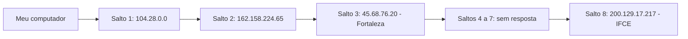

# Atividade 01: Rede (ping, nslookup e tracert)

## Evidências esperadas nesta pasta

| Arquivo | Comando que gera |
|---|---|
| `ping-ifce.txt` | `ping ifce.edu.br` |
| `nslookup-ifce.txt` | `nslookup ifce.edu.br` |
| `tracert-ifce.txt` | `tracert ifce.edu.br` |
| `nslookup-outro.txt` | `nslookup` para outro domínio |
| `tracert-outro.txt` | `tracert` para o mesmo domínio escolhido |

## Perguntas

**1.1** Qual IP foi retornado para `ifce.edu.br`? É o mesmo no `ping` e no `nslookup`?

O IP retornado foi `200.129.17.217`. Sim, o IP foi o mesmo nos dois comandos.

**1.2** Qual servidor DNS respondeu a sua consulta? Por que a resposta aparece como "não autoritativa"?

O servidor DNS foi `connectivity-check.warp-svc`, com endereço `127.0.2.2`. A resposta é não autoritativa porque esse servidor não é o responsável direto pelo domínio consultado.

**1.3** Quantos saltos o `tracert` mostrou até o IFCE? Qual foi o primeiro salto e o que ele representa?

Foram **8 saltos**, sendo que o destino foi alcançado no oitavo. O primeiro salto foi `104.28.0.0`, com tempo entre 10 e 14 ms. Ele representa o primeiro equipamento de rede encontrado no caminho até o destino.

**1.4** Algum salto mostrou `* * *`? O que isso significa?

Sim, os saltos 4, 5, 6 e 7 apresentaram `* * *`. Isso significa que esses equipamentos não responderam dentro do tempo esperado. Mesmo assim, o destino foi alcançado no salto 8.

**1.5** Qual domínio você escolheu para comparar? O caminho foi maior ou menor que o do IFCE? Por que você acha que isso aconteceu?

O domínio escolhido foi `google.com`. A quantidade de saltos precisa ser verificada com o comando `tracert google.com` e comparada com os 8 saltos do IFCE. A diferença pode ocorrer porque os destinos utilizam redes e rotas diferentes na Internet.

## Diagrama da rota até o IFCE

