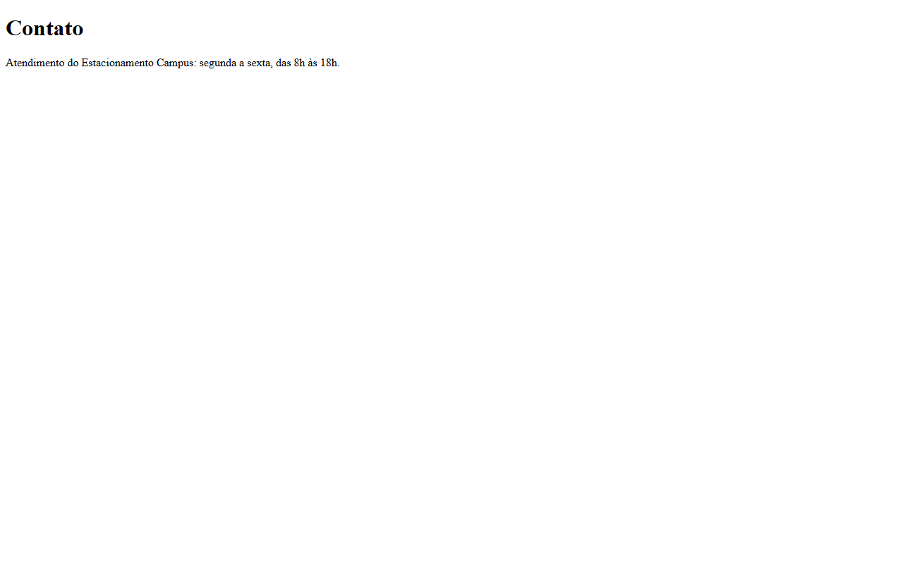

# Atividades: Rotas, Views e Controllers no Laravel

## Atividade 01

Implementei `GET /sobre` como resposta de texto simples e `GET /contato` como uma view Blade com título e informações de atendimento.

### Trecho real de `curl.exe -i http://127.0.0.1:8005/sobre`

```text
HTTP/1.1 200 OK
Content-Type: text/html; charset=utf-8

O Estacionamento Campus organiza a entrada e a saída de veículos.
```

### Trecho real de `curl.exe -i http://127.0.0.1:8005/contato`

```text
HTTP/1.1 200 OK
Content-Type: text/html; charset=utf-8

<!DOCTYPE html>
<html lang="pt-BR">
<head>
    <meta charset="UTF-8">
    <meta name="viewport" content="width=device-width, initial-scale=1.0">
    <title>Contato | Estacionamento Campus</title>
</head>
<body>
    <h1>Contato</h1>
    <p>Atendimento do Estacionamento Campus: segunda a sexta, das 8h às 18h.</p>
</body>
</html>
```

### `php artisan route:list`

```text
GET|HEAD / .. routes/web.php:5
POST _boost/browser-logs .. boost.browser-logs › vendor/laravel/boost/src/BoostServiceProvider.php:107
GET|HEAD contato .. routes/web.php:13
GET|HEAD sobre .. routes/web.php:9
GET|HEAD storage/{path} storage.local › vendor/laravel/framework/src/Illuminate/Filesystem/FilesystemServiceProvid…
PUT storage/{path} storage.local.upload › vendor/laravel/framework/src/Illuminate/Filesystem/FilesystemServic…
GET|HEAD up .. Illuminate\Foundation › HealthCheck

Showing [7] routes
```

As respostas foram capturadas com `curl.exe -i` no servidor local da atividade, usando a porta `8005` porque a `8000` já estava ocupada. Os trechos omitem os valores dos cookies de sessão e do token CSRF; na resposta de contato, também omitem o script de diagnóstico que o Laravel Boost injeta no HTML durante o desenvolvimento.

As duas rotas retornaram `text/html; charset=utf-8`: nesta aplicação o Laravel define esse tipo de conteúdo para a resposta de texto da closure e para a view HTML. No `route:list`, as colunas mostram método HTTP, URI, nome da rota e ação. As rotas do Boost, do armazenamento e de saúde também aparecem por serem registradas pelo framework/pacotes instalados.

Capturas do navegador:




## Atividade 02

Pendente.

## Atividade 03

Pendente.

## Atividade 04

Pendente.

## Atividade 05

Pendente.

## Atividade 06

Pendente.

## Atividade 07

Pendente.

## Atividade 08

Pendente.

## Atividade 09

Pendente.

## Atividade 10

Pendente.
