# Atividades: Rotas, Views e Controllers no Laravel

## Atividade 01

Implementei `GET /sobre` como resposta de texto simples e `GET /contato` como uma view Blade com título e informações de atendimento.

### Trecho real de `curl.exe -i http://127.0.0.1:8005/sobre`

```text
HTTP/1.1 200 OK
Content-Type: text/html; charset=utf-8

O Estacionamento Campus organiza a entrada e a saída de veículos.
```

### Trecho real de `curl.exe -i http://127.0.0.1:8005/contato`

```text
HTTP/1.1 200 OK
Content-Type: text/html; charset=utf-8

<!DOCTYPE html>
<html lang="pt-BR">
<head>
    <meta charset="UTF-8">
    <meta name="viewport" content="width=device-width, initial-scale=1.0">
    <title>Contato | Estacionamento Campus</title>
</head>
<body>
    <h1>Contato</h1>
    <p>Atendimento do Estacionamento Campus: segunda a sexta, das 8h às 18h.</p>
</body>
</html>
```

### `php artisan route:list`

```text
GET|HEAD / .. routes/web.php:5
POST _boost/browser-logs .. boost.browser-logs › vendor/laravel/boost/src/BoostServiceProvider.php:107
GET|HEAD contato .. routes/web.php:13
GET|HEAD sobre .. routes/web.php:9
GET|HEAD storage/{path} storage.local › vendor/laravel/framework/src/Illuminate/Filesystem/FilesystemServiceProvid…
PUT storage/{path} storage.local.upload › vendor/laravel/framework/src/Illuminate/Filesystem/FilesystemServic…
GET|HEAD up .. Illuminate\Foundation › HealthCheck

Showing [7] routes
```

As respostas foram capturadas com `curl.exe -i` no servidor local da atividade, usando a porta `8005` porque a `8000` já estava ocupada. Os trechos omitem os valores dos cookies de sessão e do token CSRF; na resposta de contato, também omitem o script de diagnóstico que o Laravel Boost injeta no HTML durante o desenvolvimento.

As duas rotas retornaram `text/html; charset=utf-8`: nesta aplicação o Laravel define esse tipo de conteúdo para a resposta de texto da closure e para a view HTML. No `route:list`, as colunas mostram método HTTP, URI, nome da rota e ação. As rotas do Boost, do armazenamento e de saúde também aparecem por serem registradas pelo framework/pacotes instalados.

Capturas do navegador:

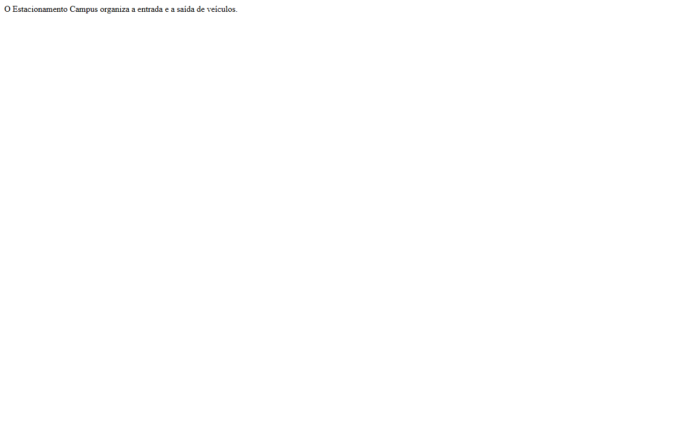


## Atividade 02

Configurei `GET /produtos/{id}` com `whereNumber('id')` e `GET /saudacao/{nome?}` com o valor padrão `visitante`.

### Capturas reais em `http://127.0.0.1:8005`

```text
GET /produtos/7
HTTP/1.1 200 OK
Content-Type: text/html; charset=utf-8
Produto 7 solicitado no Estacionamento Campus.

GET /produtos/abc
HTTP/1.1 404 Not Found
Content-Type: text/html; charset=utf-8
<title>Not Found</title>

GET /saudacao
HTTP/1.1 200 OK
Content-Type: text/html; charset=utf-8
Olá, visitante!

GET /saudacao/Ana
HTTP/1.1 200 OK
Content-Type: text/html; charset=utf-8
Olá, Ana!

Teste temporário sem o valor padrão, GET /saudacao
HTTP/1.1 500 Internal Server Error
ArgumentCountError
Too few arguments to function ...routes/web.php:21..., 0 passed ... and exactly 1 expected
```

`abc` recebe 404 porque não satisfaz a restrição numérica da rota. O `?` indica que o segmento `nome` é opcional. O valor padrão no parâmetro PHP permite chamar a closure sem argumento; removê-lo tornou o argumento obrigatório e gerou o `ArgumentCountError` registrado acima. Recoloquei o valor padrão após o teste. Valores de cookies, IDs de sessão e partes do caminho absoluto da mensagem foram omitidos.


## Atividade 03

Nomeei a rota de apresentação como `sobre`, usei `route('sobre')` no link da página de contato, adicionei o redirecionamento `/inicio` e uma rota fallback com resposta 404. Também alterei a URI de apresentação para `/quem-somos`; o nome `sobre` foi mantido, então o link gerado continua apontando para a nova URI.

### Capturas reais em `http://127.0.0.1:8005`

```text
GET /inicio
HTTP/1.1 302 Found
Location: http://127.0.0.1:8005
Content-Type: text/html; charset=utf-8

GET /qualquer-coisa
HTTP/1.1 404 Not Found
Content-Type: text/html; charset=utf-8
<title>Página não encontrada | Estacionamento Campus</title>
<h1>404 - Página não encontrada</h1>

GET /quem-somos
HTTP/1.1 200 OK
Content-Type: text/html; charset=utf-8

GET /sobre
HTTP/1.1 404 Not Found
Content-Type: text/html; charset=utf-8

GET /contato (link renderizado)
<a href="http://127.0.0.1:8005/quem-somos">Sobre o estacionamento</a>
```

O redirecionamento retorna 302 e informa o destino no cabeçalho `Location`. A função `route('sobre')` resolve o endereço pelo nome registrado, não por uma string fixa; por isso, o link segue funcionando após a alteração da URI. A URL antiga `/sobre` deixa de corresponder à rota e recebe o fallback 404.


## Atividade 04

Criei `POST /mensagem` como uma rota exclusiva para receber uma mensagem. Um `GET` no mesmo URI não executa essa ação.

### Capturas reais em `http://127.0.0.1:8005`

```text
GET /mensagem
HTTP/1.1 404 Not Found
Content-Type: text/html; charset=utf-8
<title>Página não encontrada | Estacionamento Campus</title>
<h1>404 - Página não encontrada</h1>

curl.exe -i -X POST http://127.0.0.1:8005/mensagem
HTTP/1.1 419 unknown status
Content-Type: text/html; charset=utf-8
<title>Page Expired</title>
```

| Requisição | Status observado |
|---|---:|
| `GET /sobre` | 404 |
| `GET /inicio` | 302 |
| `GET /produtos/abc` | 404 |
| `GET /mensagem` | 404 |
| `POST /mensagem` sem token | 419 |

O `GET /mensagem` exibiu o fallback personalizado (404), pois a rota fallback também corresponde a métodos sem rota específica; não apareceu 405 neste projeto. O middleware CSRF compara o token enviado no formulário com o token associado à sessão do navegador. O cookie identifica a sessão; `@csrf` colocará o token oculto no formulário, que será enviado no POST junto com o cookie. O POST sem token foi rejeitado com 419. Valores dos cookies foram omitidos do registro.


## Atividade 05

Criei `layouts/app.blade.php` para a estrutura comum, `partials/menu.blade.php` para os links nomeados e `public/css/estilo.css` para os estilos. A página inicial, a página sobre e o contato agora estendem o layout.

### Capturas do navegador

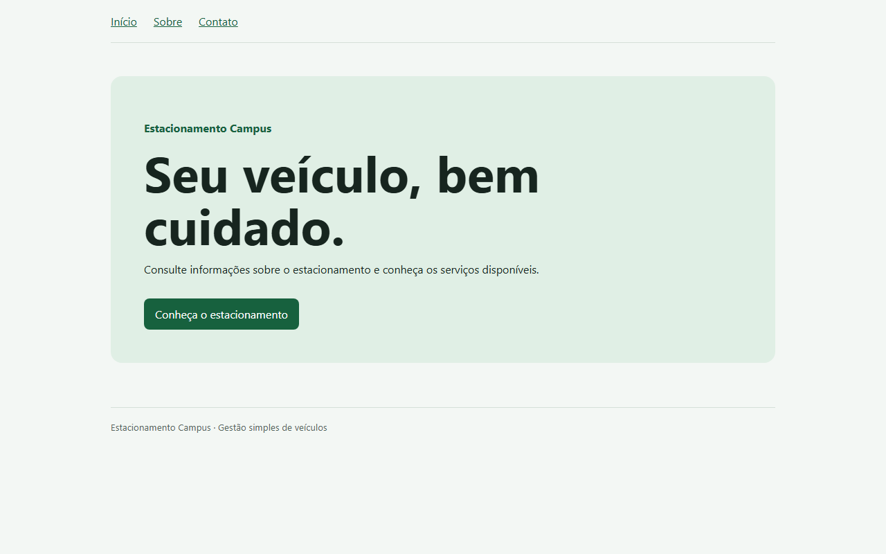

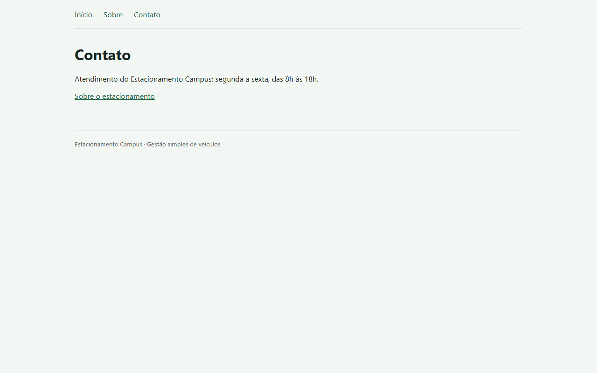

### Teste temporário sem `@endsection`

```text
GET /contato, removendo temporariamente @endsection
HTTP/1.1 200 OK
Content-Type: text/html; charset=utf-8
<h1>Contato</h1>
<a href="http://127.0.0.1:8005/quem-somos">Sobre o estacionamento</a>
```

O teste não gerou erro: o conteúdo da seção continuou presente no HTML. Recoloquei `@endsection` depois do teste. O CSS foi servido com status 200 e `Content-Type: text/css; charset=UTF-8`.

As diretivas Blade não aparecem no HTML servido: o Laravel compila e renderiza os templates no servidor. Os links usam `route()` para acompanhar os nomes das rotas. O CSS fica em `public/` porque os arquivos dessa pasta são servidos diretamente como recursos estáticos.

## Atividade 06

Adicionei a rota nomeada `produtos.index` e uma view Blade com tabela de vagas e serviços. `@forelse` percorre os dados, `@empty` apresenta uma mensagem quando a lista está vazia, e `@if` destaca valores acima de R$ 30,00.

### Saídas HTTP observadas

```text
GET /produtos (lista preenchida)
HTTP/1.1 200 OK
Content-Type: text/html; charset=utf-8
Vaga coberta para carro — R$ 42,00 (destaque)
Vaga para motocicleta — R$ 18,00
Vaga com carregamento elétrico — R$ 36,50 (destaque)

GET /produtos (lista temporariamente vazia)
HTTP/1.1 200 OK
<td colspan="2">Nenhuma vaga disponível.</td>

Nome de teste: <script>alert("invadido")</script>
Com {{ }}:
<td>&lt;script&gt;alert(&quot;invadido&quot;)&lt;/script&gt;</td>

Com {!! !!} temporariamente:
<td><script>alert("invadido")</script></td>
```

O nome e a lista vazia foram dados de teste temporários e removidos após as capturas; a view final voltou a usar `{{ }}`. A saída raw foi inspecionada por `curl.exe`, sem executá-la em um navegador. `{{ }}` escapa HTML, como `htmlspecialchars`, impedindo que a string seja interpretada como marcação/script. `{!! !!}` não escapa o conteúdo e deve ser reservado a HTML confiável. `@forelse` evita uma verificação e um loop separados ao oferecer o ramo `@empty`.


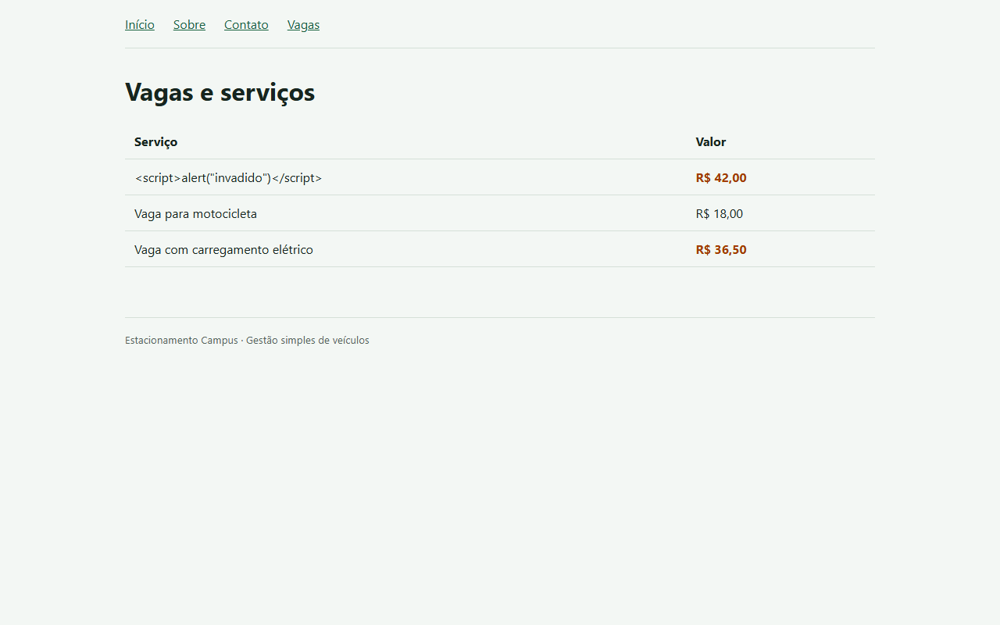

## Atividade 07

Gerei `app/Http/Controllers/PaginaController.php` e movi as ações de início, sobre e contato para `inicio()`, `sobre()` e `contato()`. Os nomes e as URIs das rotas foram mantidos.

### Comparação de `php artisan route:list --except-vendor`

Antes, as ações das três páginas eram closures em `routes/web.php`:

```text
GET|HEAD / .. inicio › routes/web.php:5
GET|HEAD contato .. contato › routes/web.php:13
GET|HEAD quem-somos .. sobre › routes/web.php:9
```

Depois, a coluna de ação identifica os métodos do controller:

```text
GET|HEAD / .. inicio › PaginaController@inicio
GET|HEAD contato .. contato › PaginaController@contato
GET|HEAD quem-somos .. sobre › PaginaController@sobre
```

Teste temporário com o método digitado como `sobr`:

```text
GET /quem-somos
HTTP/1.1 500 Internal Server Error
Call to undefined method App\Http\Controllers\PaginaController::sobr()
```

Corrigi o nome do método depois do teste. O controller usa o namespace `App\Http\Controllers`, que o autoload PSR-4 do Composer associa à pasta `app/Http/Controllers`. A coluna de ação deixa visível o vínculo entre cada rota e o método chamado.

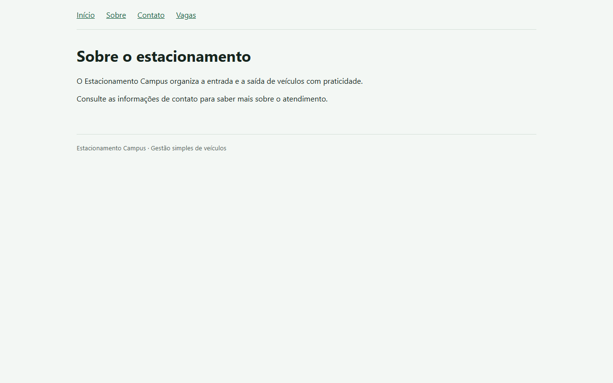

## Atividade 08

Reaproveitei a hierarquia de veículos do projeto anterior e adicionei `Van` como quarto tipo concreto. `VeiculoController` monta quatro objetos de classes diferentes e os envia às views `produtos.index` e `produtos.show`. As rotas preservam os nomes `produtos.index` e `produtos.show`.

### `php artisan route:list --name=produtos`

```text
GET|HEAD produtos .. produtos.index › VeiculoController@index
GET|HEAD produtos/{id} .. produtos.show › VeiculoController@show

Showing [2] routes
```

### Capturas reais em `http://127.0.0.1:8005`

```text
GET /produtos
HTTP/1.1 200 OK
ABC1D23 — carro — Sedan — R$ 30,00
XYZ2E34 — moto — CG 160 — R$ 15,00
BRA3F45 — caminhonete — Hilux — R$ 40,00
QRS4G56 — van — Sprinter — R$ 50,00

GET /produtos/1
HTTP/1.1 200 OK
XYZ2E34
Tipo: moto
Modelo: CG 160
1 hora(s): R$ 3,00
2 hora(s): R$ 6,00
5 hora(s): R$ 15,00

GET /produtos/99
HTTP/1.1 404 Not Found
<title>Not Found</title>
```

O mesmo método `calcularTarifa()` produz valores diferentes conforme a classe concreta — isso é polimorfismo. `show(int $id)` chama `abort_unless` quando o índice não existe, e o Laravel responde 404. Os fluxos são `GET /produtos → VeiculoController@index → objetos do domínio → produtos.index` e `GET /produtos/1 → VeiculoController@show → produtos.show`.

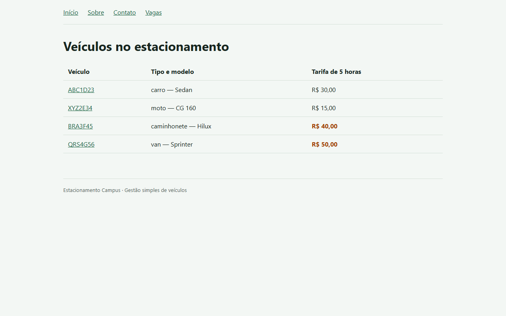

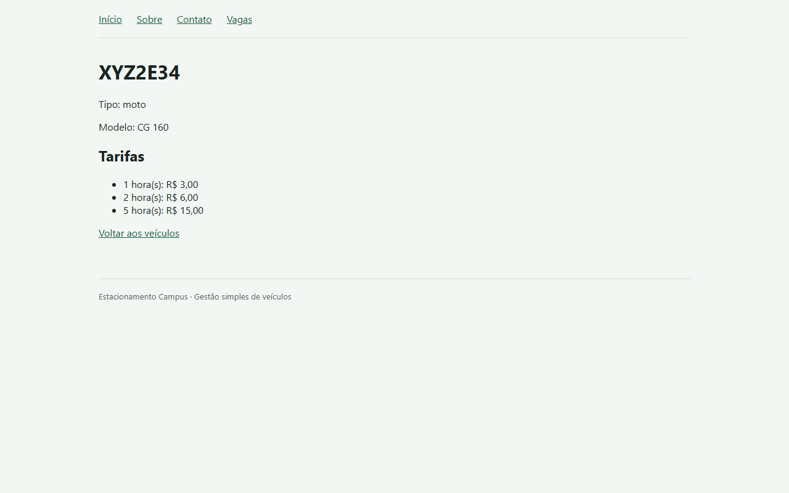

## Atividade 09

Adicionei GET `/produtos/create` (`produtos.create`) e POST `/produtos` (`produtos.store`). O formulário usa `@csrf`, `old()` e `@error`; o controller valida os dados, instancia a subclasse de veículo escolhida e guarda seu array na sessão `cadastrados`. A lista combina os exemplos fixos com os veículos cadastrados, e uma mensagem flash confirma o POST. Como a tarifa é calculada pela classe concreta, adaptei o campo numérico de preço do exemplo para tempo previsto em horas.

### `php artisan route:list --name=produtos`

```text
GET|HEAD produtos .. produtos.index › VeiculoController@index
POST produtos .. produtos.store › VeiculoController@store
GET|HEAD produtos/create .. produtos.create › VeiculoController@create
GET|HEAD produtos/{id} .. produtos.show › VeiculoController@show

Showing [4] routes
```

### Testes HTTP reais em `http://127.0.0.1:8005`

```text
POST /produtos (campos vazios, token CSRF válido)
HTTP 302 Found
Location: /produtos/create
Após seguir o redirect, o formulário mostra:
O campo tipo é obrigatório.
O campo placa é obrigatório.
O campo modelo é obrigatório.
O campo tempo previsto é obrigatório.

POST /produtos (horas=texto, token CSRF válido)
HTTP 302 Found
Location: /produtos/create
Após seguir o redirect, o formulário mostra:
O campo tempo previsto deve ser numérico.

POST /produtos (veículo van, placa JKL5M67, modelo Sprinter, horas=2.5)
HTTP 302 Found
Location: /produtos
GET /produtos na mesma sessão:
Veículo JKL5M67 cadastrado com sucesso.
JKL5M67 — van — Sprinter

POST /produtos sem @csrf temporário e sem token
HTTP 419
<title>Page Expired</title>
```

Também removi temporariamente `@csrf` do formulário e confirmei que o HTML não continha o campo `_token`; o POST foi recusado com 419. Restaurei a diretiva no código final. A sessão foi preservada entre o POST e o GET seguinte; diferentemente de um banco de dados, essa implementação de demonstração mantém os cadastros associados à sessão do visitante.

`old()` repõe os dados submetidos depois do redirect de validação, e `@error` mostra as mensagens junto aos campos. O POST seguido de redirect e GET aplica o padrão Post/Redirect/Get. O token oculto emitido por `@csrf` é validado em relação à sessão; sem ele, o Laravel rejeita a requisição.

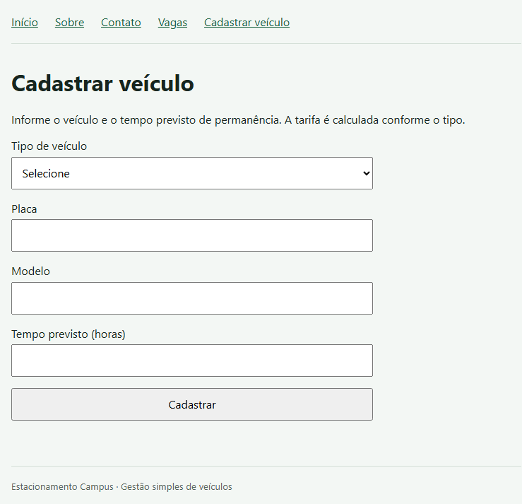

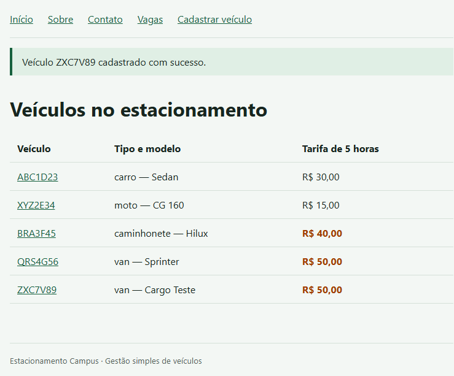

## Atividade 10

Criei a classe de domínio `Estacionamento`, que é composta por uma coleção de objetos `Veiculo`, e o `EstacionamentoController`. Os registros e seus veículos serializados ficam na sessão. `Route::resource('estacionamentos', ...)` gera as sete rotas REST; implementei index, create, store, show, edit, update e destroy. As views permitem criar uma composição, ver seus veículos, editar e excluir; a exclusão usa `@csrf` e `@method('DELETE')`.

### `php artisan route:list --name=estacionamentos`

```text
GET|HEAD estacionamentos .. estacionamentos.index › EstacionamentoController@index
POST estacionamentos .. estacionamentos.store › EstacionamentoController@store
GET|HEAD estacionamentos/create .. estacionamentos.create › EstacionamentoController@create
GET|HEAD estacionamentos/{estacionamento} .. estacionamentos.show › EstacionamentoController@show
PUT|PATCH estacionamentos/{estacionamento} .. estacionamentos.update › EstacionamentoController@update
DELETE estacionamentos/{estacionamento} .. estacionamentos.destroy › EstacionamentoController@destroy
GET|HEAD estacionamentos/{estacionamento}/edit .. estacionamentos.edit › EstacionamentoController@edit

Showing [7] routes
```

### Mapeamento das rotas

| Ação | Verbo | URI | Nome | Finalidade |
|---|---|---|---|---|
| index | GET | `/estacionamentos` | `estacionamentos.index` | Listar os estacionamentos da sessão |
| create | GET | `/estacionamentos/create` | `estacionamentos.create` | Exibir o formulário de criação |
| store | POST | `/estacionamentos` | `estacionamentos.store` | Validar e salvar uma composição na sessão |
| show | GET | `/estacionamentos/{estacionamento}` | `estacionamentos.show` | Mostrar um estacionamento e seus veículos |
| edit | GET | `/estacionamentos/{estacionamento}/edit` | `estacionamentos.edit` | Exibir o formulário de edição |
| update | PUT/PATCH | `/estacionamentos/{estacionamento}` | `estacionamentos.update` | Validar e salvar as alterações |
| destroy | DELETE | `/estacionamentos/{estacionamento}` | `estacionamentos.destroy` | Excluir a composição da sessão |

### Testes HTTP reais em `http://127.0.0.1:8005`

```text
GET /estacionamentos (sessão sem registros)
HTTP/1.1 200 OK
Nenhum estacionamento cadastrado.

POST /estacionamentos (nome=Estacionamento Central, veículos ABC1D23 e XYZ2E34)
HTTP/1.1 302 Found
Location: http://127.0.0.1:8005/estacionamentos/1

GET /estacionamentos/1
HTTP/1.1 200 OK
Estacionamento Central
ABC1D23 — carro — Sedan
XYZ2E34 — moto — CG 160

POST /estacionamentos/1 com @csrf e @method('DELETE')
HTTP/1.1 302 Found
Location: http://127.0.0.1:8005/estacionamentos

GET /estacionamentos após a exclusão
HTTP/1.1 200 OK
Nenhum estacionamento cadastrado.

curl.exe -i -X DELETE http://127.0.0.1:8005/estacionamentos/1 (sem sessão/token)
HTTP/1.1 419 unknown status
<title>Page Expired</title>
```

O formulário HTML envia POST e `@method('DELETE')` inclui `_method=DELETE`; o Laravel interpreta o POST como DELETE, e `@csrf` fornece o token vinculado à sessão. O comando cURL direto não enviou sessão nem token, então o middleware CSRF respondeu 419 antes de o controller procurar o ID; não foi um 404 nem uma falha da rota. O servidor da atividade está na porta 8005, pois a porta 8000 já estava ocupada. `Route::resource` reduz a configuração repetitiva e padroniza os nomes e URIs, mas é importante implementar as ações geradas para não deixar endpoints sem comportamento.

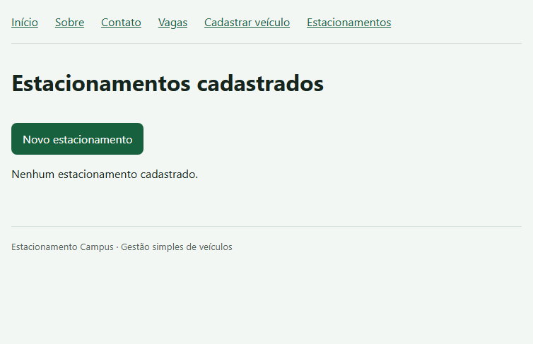

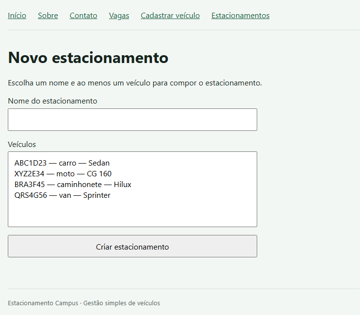

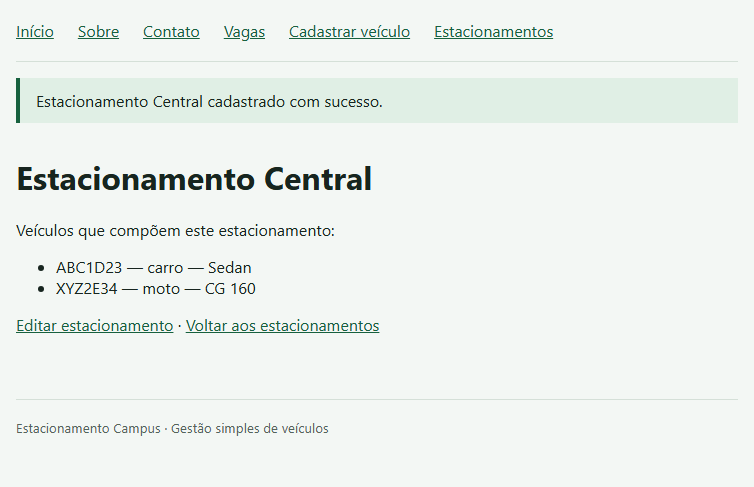


