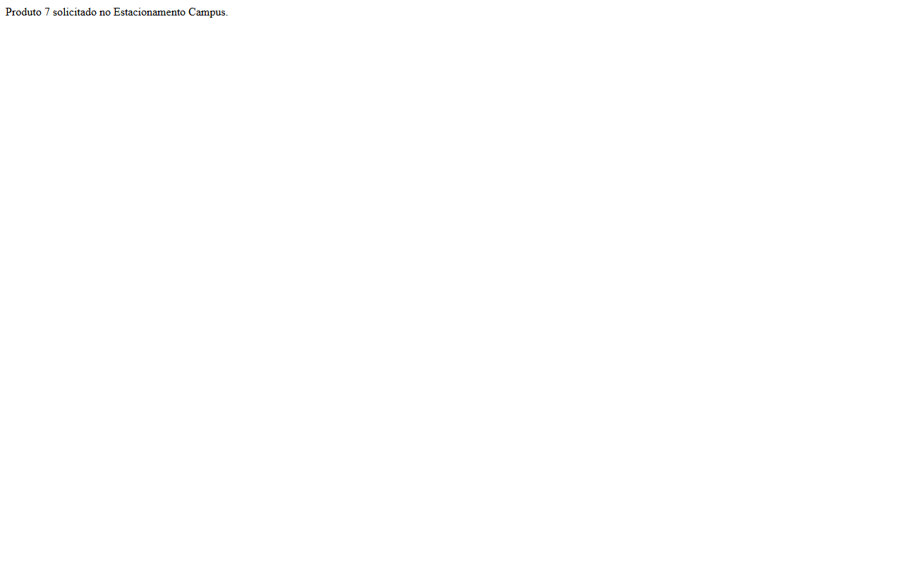
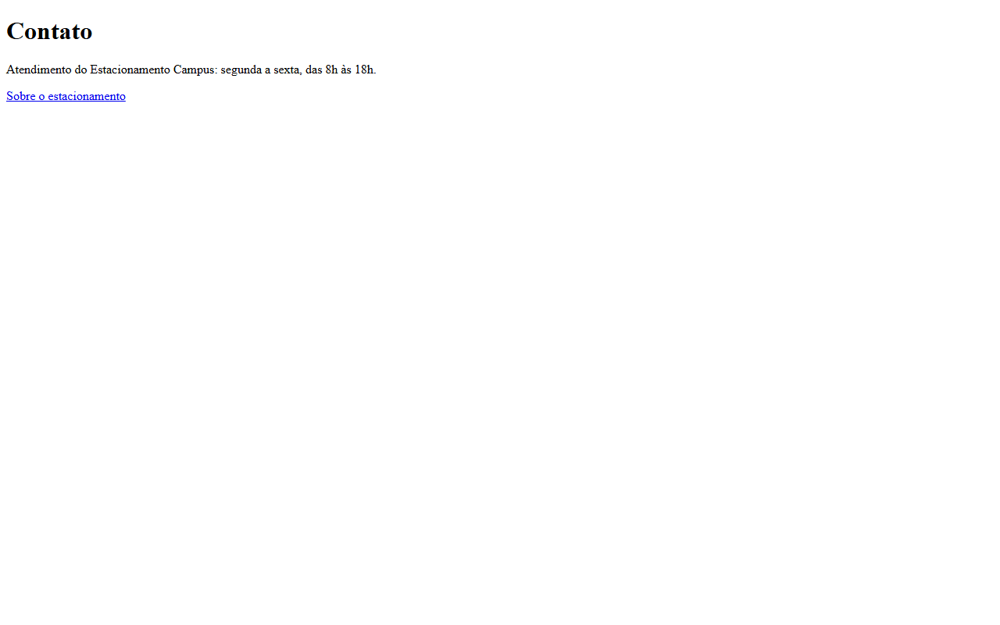

# Atividades: Rotas, Views e Controllers no Laravel

## Atividade 01

Implementei `GET /sobre` como resposta de texto simples e `GET /contato` como uma view Blade com título e informações de atendimento.

### Trecho real de `curl.exe -i http://127.0.0.1:8005/sobre`

```text
HTTP/1.1 200 OK
Content-Type: text/html; charset=utf-8

O Estacionamento Campus organiza a entrada e a saída de veículos.
```

### Trecho real de `curl.exe -i http://127.0.0.1:8005/contato`

```text
HTTP/1.1 200 OK
Content-Type: text/html; charset=utf-8

<!DOCTYPE html>
<html lang="pt-BR">
<head>
    <meta charset="UTF-8">
    <meta name="viewport" content="width=device-width, initial-scale=1.0">
    <title>Contato | Estacionamento Campus</title>
</head>
<body>
    <h1>Contato</h1>
    <p>Atendimento do Estacionamento Campus: segunda a sexta, das 8h às 18h.</p>
</body>
</html>
```

### `php artisan route:list`

```text
GET|HEAD / .. routes/web.php:5
POST _boost/browser-logs .. boost.browser-logs › vendor/laravel/boost/src/BoostServiceProvider.php:107
GET|HEAD contato .. routes/web.php:13
GET|HEAD sobre .. routes/web.php:9
GET|HEAD storage/{path} storage.local › vendor/laravel/framework/src/Illuminate/Filesystem/FilesystemServiceProvid…
PUT storage/{path} storage.local.upload › vendor/laravel/framework/src/Illuminate/Filesystem/FilesystemServic…
GET|HEAD up .. Illuminate\Foundation › HealthCheck

Showing [7] routes
```

As respostas foram capturadas com `curl.exe -i` no servidor local da atividade, usando a porta `8005` porque a `8000` já estava ocupada. Os trechos omitem os valores dos cookies de sessão e do token CSRF; na resposta de contato, também omitem o script de diagnóstico que o Laravel Boost injeta no HTML durante o desenvolvimento.

As duas rotas retornaram `text/html; charset=utf-8`: nesta aplicação o Laravel define esse tipo de conteúdo para a resposta de texto da closure e para a view HTML. No `route:list`, as colunas mostram método HTTP, URI, nome da rota e ação. As rotas do Boost, do armazenamento e de saúde também aparecem por serem registradas pelo framework/pacotes instalados.

Capturas do navegador:


## Atividade 02

Configurei `GET /produtos/{id}` com `whereNumber('id')` e `GET /saudacao/{nome?}` com o valor padrão `visitante`.

### Capturas reais em `http://127.0.0.1:8005`

```text
GET /produtos/7
HTTP/1.1 200 OK
Content-Type: text/html; charset=utf-8
Produto 7 solicitado no Estacionamento Campus.

GET /produtos/abc
HTTP/1.1 404 Not Found
Content-Type: text/html; charset=utf-8
<title>Not Found</title>

GET /saudacao
HTTP/1.1 200 OK
Content-Type: text/html; charset=utf-8
Olá, visitante!

GET /saudacao/Ana
HTTP/1.1 200 OK
Content-Type: text/html; charset=utf-8
Olá, Ana!

Teste temporário sem o valor padrão, GET /saudacao
HTTP/1.1 500 Internal Server Error
ArgumentCountError
Too few arguments to function ...routes/web.php:21..., 0 passed ... and exactly 1 expected
```

`abc` recebe 404 porque não satisfaz a restrição numérica da rota. O `?` indica que o segmento `nome` é opcional. O valor padrão no parâmetro PHP permite chamar a closure sem argumento; removê-lo tornou o argumento obrigatório e gerou o `ArgumentCountError` registrado acima. Recoloquei o valor padrão após o teste. Valores de cookies, IDs de sessão e partes do caminho absoluto da mensagem foram omitidos.



## Atividade 03

Nomeei a rota de apresentação como `sobre`, usei `route('sobre')` no link da página de contato, adicionei o redirecionamento `/inicio` e uma rota fallback com resposta 404. Também alterei a URI de apresentação para `/quem-somos`; o nome `sobre` foi mantido, então o link gerado continua apontando para a nova URI.

### Capturas reais em `http://127.0.0.1:8005`

```text
GET /inicio
HTTP/1.1 302 Found
Location: http://127.0.0.1:8005
Content-Type: text/html; charset=utf-8

GET /qualquer-coisa
HTTP/1.1 404 Not Found
Content-Type: text/html; charset=utf-8
<title>Página não encontrada | Estacionamento Campus</title>
<h1>404 - Página não encontrada</h1>

GET /quem-somos
HTTP/1.1 200 OK
Content-Type: text/html; charset=utf-8

GET /sobre
HTTP/1.1 404 Not Found
Content-Type: text/html; charset=utf-8

GET /contato (link renderizado)
<a href="http://127.0.0.1:8005/quem-somos">Sobre o estacionamento</a>
```

O redirecionamento retorna 302 e informa o destino no cabeçalho `Location`. A função `route('sobre')` resolve o endereço pelo nome registrado, não por uma string fixa; por isso, o link segue funcionando após a alteração da URI. A URL antiga `/sobre` deixa de corresponder à rota e recebe o fallback 404.



## Atividade 04

Pendente.

## Atividade 05

Pendente.

## Atividade 06

Pendente.

## Atividade 07

Pendente.

## Atividade 08

Pendente.

## Atividade 09

Pendente.

## Atividade 10

Pendente.
