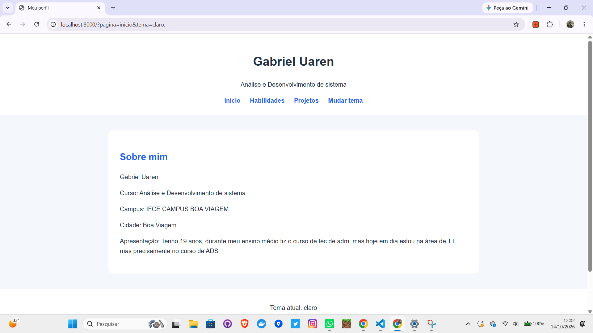
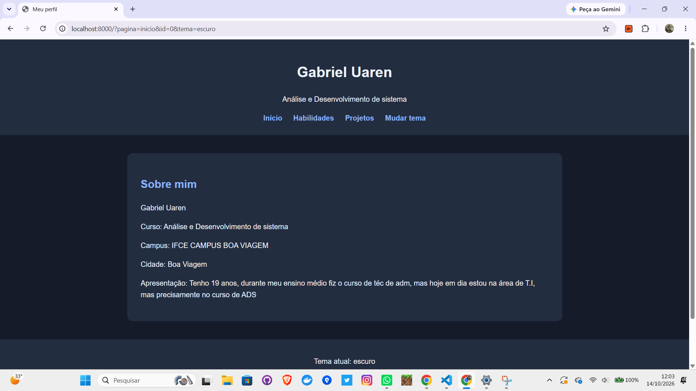

# Perfil do Estudante: versão 2

**Autor(a):** Gabriel Uaren

## Como executar

Abra o terminal na pasta do repositório e execute:

```powershell
cd projeto/v2
php -S localhost:8000 -d display_errors=1 -d output_buffering=0
```

Abra http://localhost:8000

## Telas

| Tema claro | Tema escuro |
|---|---|
|  |  |

## 1. Mapa de rotas

| URL | O que mostra | Status |
|---|---|---|
| `/` | Página inicial com minhas informações | 200 OK |
| `/?pagina=habilidades` | Minhas habilidades e a quantidade delas | 200 OK |
| `/?pagina=projetos` | Lista dos três projetos | 200 OK |
| `/?pagina=projeto&id=2` | Detalhes do segundo projeto | 200 OK |
| `/?pagina=projeto&id=99` | Projeto não encontrado | 404 Not Found |
| `/?pagina=qualquercoisa` | Página não encontrada | 404 Not Found |
| `/?tema=escuro` | Página inicial com tema escuro | 200 OK |
| `/?formato=json` | Dados do perfil e dos projetos em JSON | 200 OK |

## 2. Saídas do terminal

### 2.1 Uma página que existe

**Comando:**

`curl.exe -i "http://localhost:8000/?pagina=projeto&id=2"`

**Saída do terminal:**

```text
HTTP/1.1 200 OK
Host: localhost:8000
Date: Wed, 28 Oct 2026 22:33:17 GMT
Connection: close
X-Powered-By: PHP/8.5.11
Content-type: text/html; charset=UTF-8
```

Na página apareceu:

```text
Calcula dois números
Calcula dois números
Tecnologias: PHP
```

**Explicação:**

O código 200 OK significa que o projeto foi encontrado e a página funcionou normalmente. Na V2, usei o método `getProjeto()` da classe `Perfil` para procurar o projeto pelo ID. Depois, os getters da classe `Projeto` mostram o título, a descrição e as tecnologias.

### 2.2 Uma página que não existe

**Comando:**

`curl.exe -i "http://localhost:8000/?pagina=projeto&id=99"`

**Saída do terminal:**

```text
HTTP/1.1 404 Not Found
Host: localhost:8000
Date: Wed, 28 Oct 2026 22:33:24 GMT
Connection: close
X-Powered-By: PHP/8.5.11
Content-type: text/html; charset=UTF-8
```

Na página apareceu:

```text
Projeto não encontrado.
```

**Explicação:**

O código 404 significa que o projeto solicitado não existe. Na V2, o método `getProjeto()` lança uma exceção quando não encontra o projeto. Usei `try/catch` para tratar essa exceção e `http_response_code(404)` para informar o erro.

### 2.3 A troca de tema

**Comando:**

`curl.exe -i "http://localhost:8000/?tema=escuro"`

**Resultado esperado:**

```text
HTTP/1.1 200 OK
Set-Cookie: tema=escuro; ...
Content-type: text/html; charset=UTF-8
```

No HTML, o tema escolhido aparece assim:

```html
<body class="tema-escuro">
```

**Explicação:**

O cabeçalho `Set-Cookie` salva o tema escuro no navegador por 30 dias. Quando a pessoa entra novamente no site, o PHP usa `$_COOKIE` para recuperar o tema escolhido. Essa funcionalidade foi mantida da V1.

**Observação:** esse resultado é o comportamento esperado pelo código. O teste específico do cookie ainda precisa ser executado na V2.

### 2.4 A API

**Comando:**

`curl.exe -i "http://localhost:8000/?formato=json"`

**Saída do terminal:**

```text
HTTP/1.1 200 OK
Host: localhost:8000
Date: Wed, 28 Oct 2026 22:33:30 GMT
Connection: close
X-Powered-By: PHP/8.5.11
Content-Type: application/json; charset=utf-8

{
    "perfil": {
        "nome": "Gabriel Uaren",
        "curso": "Análise e Desenvolvimento de sistema",
        "campus": "IFCE CAMPUS BOA VIAGEM",
        "cidade": "Boa Viagem",
        "apresentacao": "Tenho 19 anos, durante meu ensino médio fiz o curso de téc de adm, mas hoje em dia estou na área de T.I, mas precisamente no curso de ADS",
        "habilidades": [
            "Comunicação",
            "Organização",
            "Trabalho em equipe",
            "Resolução de problemas",
            "Criatividade"
        ]
    },
    "projetos": {
        "1": {
            "titulo": "Curadoria de Livros Nacionais",
            "descricao": "Site para apresentar livros nacionais, seus autores e gêneros literários.",
            "tecnologias": "Html, Java Script e Css"
        },
        "2": {
            "titulo": "Calcula dois números",
            "descricao": "Calcula dois números",
            "tecnologias": "PHP"
        },
        "3": {
            "titulo": "Vantage",
            "descricao": "O Vantage ajuda pequenos empresários a organizar suas finanças e separar o dinheiro pessoal do empresarial.",
            "tecnologias": "Ionic/Angular e Python"
        }
    }
}
```

**Explicação:**

Quando a URL recebe `formato=json`, o PHP retorna os dados do perfil e dos projetos em formato JSON, em vez de mostrar o site normal.

Na V1, eu usava os arrays diretamente. Agora, na V2, uso o método `paraArray()` para transformar os objetos em arrays. Depois, `json_encode()` gera o JSON.

O formato da resposta continua igual ao da V1.

### 2.5 Resumo das três requisições testadas

| Requisição | Resultado | Data |
|---|---|---|
| `GET /?pagina=projeto&id=2` | 200 OK | 28/10/2026 |
| `GET /?pagina=projeto&id=99` | 404 Not Found | 28/10/2026 |
| `GET /?formato=json` | 200 OK | 28/10/2026 |

**Explicação:**

Os três testes foram feitos pelo terminal usando `curl.exe`. O código 200 significa que a requisição funcionou normalmente, enquanto o 404 indica que o projeto solicitado não foi encontrado.

## 3. Onde usei cada conceito

| Conceito | Onde usei no `index.php` | Para que usei |
|---|---|---|
| Classe `Projeto` | Início do arquivo | Para representar cada projeto |
| Classe `Perfil` | Depois da classe `Projeto` | Para guardar minhas informações e projetos |
| Atributos privados | Dentro das duas classes | Para proteger os dados |
| `__construct()` | Nas duas classes | Para receber os dados quando os objetos são criados |
| Getters | Nas duas classes e no HTML | Para consultar os dados privados |
| `adicionarProjeto()` | Classe `Perfil` | Para cadastrar projetos automaticamente |
| `getProjeto()` | Classe `Perfil` e controle de páginas | Para procurar um projeto pelo ID |
| `paraArray()` | Nas duas classes e na rota JSON | Para transformar os objetos em arrays |
| `throw new Exception()` | Validações e busca de projetos | Para informar erros |
| `try/catch` | Controle da página de projeto | Para tratar o erro de projeto inexistente |
| `$_GET` e `??` | Leitura de tema, página, ID e formato | Para pegar informações da URL e definir valores padrão |
| `if` / `elseif` / `else` | Condições das páginas | Para decidir qual conteúdo mostrar |
| `htmlspecialchars()` | Exibição dos dados no HTML | Para mostrar os textos com mais segurança |
| `setcookie()` e `$_COOKIE` | Parte de escolha do tema | Para salvar e recuperar o tema escolhido |
| `http_response_code(404)` | Verificação de páginas e projetos | Para retornar o erro 404 |
| `header()` e `json_encode()` | Rota JSON | Para informar o formato da resposta e gerar o JSON |
| `implode()` e `count()` | Página de habilidades | Para juntar as habilidades em um texto e contar quantas existem |

## 4. Classes e métodos

### 4.1 Classe Projeto

A classe `Projeto` foi criada para guardar as informações de cada projeto.

**Atributos:**

| Atributo | Tipo | Descrição |
|---|---|---|
| `$titulo` | string | Nome do projeto |
| `$descricao` | string | Descrição do projeto |
| `$tecnologias` | string | Tecnologias utilizadas |

**Métodos:**

| Método | Descrição |
|---|---|
| `__construct()` | Recebe as informações do projeto |
| `getTitulo()` | Retorna o título |
| `getDescricao()` | Retorna a descrição |
| `getTecnologias()` | Retorna as tecnologias |
| `paraArray()` | Converte o projeto em array |

Todos os atributos são privados.

### 4.2 Classe Perfil

A classe `Perfil` foi criada para guardar as informações do estudante, suas habilidades e seus projetos.

**Atributos:**

| Atributo | Tipo | Descrição |
|---|---|---|
| `$nome` | string | Nome do estudante |
| `$curso` | string | Curso |
| `$campus` | string | Campus |
| `$cidade` | string | Cidade |
| `$apresentacao` | string | Apresentação pessoal |
| `$habilidades` | array | Lista de habilidades |
| `$projetos` | array | Projetos cadastrados |

**Métodos:**

| Método | Descrição |
|---|---|
| `__construct()` | Recebe as informações do perfil |
| `adicionarProjeto()` | Adiciona um projeto |
| `getProjeto()` | Procura um projeto pelo ID |
| `getNome()` | Retorna o nome |
| `getCurso()` | Retorna o curso |
| `getCampus()` | Retorna o campus |
| `getCidade()` | Retorna a cidade |
| `getApresentacao()` | Retorna a apresentação |
| `getHabilidades()` | Retorna as habilidades |
| `getProjetos()` | Retorna os projetos |
| `paraArray()` | Converte o perfil e os projetos em arrays |

Todos os atributos são privados.

## 5. Comparação entre a V1 e a V2

### 5.1 Antes: usando arrays

Na V1, as informações eram guardadas em arrays associativos.

```php
$perfil = [
    "nome" => "Gabriel Uaren",
    "curso" => "Análise e Desenvolvimento de sistema"
];
```

Para mostrar o nome, eu usava:

```php
echo $perfil["nome"];
```

### 5.2 Depois: usando objetos

Na V2, crio o perfil usando a classe `Perfil`.

```php
$perfil = new Perfil(
    "Gabriel Uaren",
    "Análise e Desenvolvimento de sistema",
    "IFCE CAMPUS BOA VIAGEM",
    "Boa Viagem",
    "Minha apresentação",
    [
        "Comunicação",
        "Organização",
        "Trabalho em equipe",
        "Resolução de problemas",
        "Criatividade"
    ]
);
```

Para mostrar o nome, agora uso:

```php
echo $perfil->getNome();
```

**Explicação:**

Antes, eu acessava as informações diretamente pelo array. Agora, uso os getters da classe para consultar os dados do objeto.

### 5.3 Antes: projetos em arrays

```php
$projetos = [
    1 => [
        "titulo" => "Curadoria de Livros Nacionais",
        "descricao" => "Site para apresentar livros nacionais.",
        "tecnologias" => "HTML, JavaScript e CSS"
    ]
];
```

### 5.4 Depois: projetos como objetos

```php
$perfil->adicionarProjeto(new Projeto(
    "Curadoria de Livros Nacionais",
    "Site para apresentar livros nacionais, seus autores e gêneros literários.",
    "Html, Java Script e Css"
));
```

**Explicação:**

Na V2, cada projeto é um objeto da classe `Projeto`. O método `adicionarProjeto()` coloca esse objeto dentro do perfil e cria seu ID automaticamente.

## 6. Validações e exceções

### 6.1 Projeto sem título

Na classe `Projeto`, usei:

```php
if (trim($titulo) === '') {
    throw new Exception("O projeto precisa de um título.");
}
```

**Explicação:**

Esse código impede que um projeto seja criado com título vazio ou apenas espaços.

**Mensagem da exceção:** `O projeto precisa de um título.`

### 6.2 Perfil com menos de cinco habilidades

Na classe `Perfil`, usei:

```php
if (count($habilidades) < 5) {
    throw new Exception("O perfil precisa de pelo menos 5 habilidades.");
}
```

**Explicação:**

Esse código impede que um perfil seja criado com menos de cinco habilidades.

**Mensagem da exceção:** `O perfil precisa de pelo menos 5 habilidades.`

### 6.3 Projeto inexistente

Na classe `Perfil`, usei:

```php
if (!isset($this->projetos[$id])) {
    throw new Exception("Projeto não encontrado.");
}
```

Depois, tratei o erro com `try/catch`:

```php
try {
    $projetoSelecionado = $perfil->getProjeto($id);
} catch (Exception $erro) {
    $erroProjeto = $erro->getMessage();
    http_response_code(404);
}
```

**Explicação:**

Quando o projeto não existe, o método lança uma exceção. O `catch` recebe o erro e o site mostra a mensagem "Projeto não encontrado.", retornando o código 404.

## 7. Perguntas sobre orientação a objetos

### 7.1 Por que `json_encode($perfil)` retorna `{}`?

Porque os atributos da classe `Perfil` são privados. O `json_encode()` não consegue acessar diretamente esses atributos para montar o JSON.

Por isso, usei o método `paraArray()` para devolver as informações em um array, que pode ser convertido normalmente.

### 7.2 Os objetos continuam existindo depois que a página é atualizada?

Não. Cada vez que alguém acessa ou atualiza a página, o PHP executa o código novamente e cria novos objetos.

Para guardar informações permanentemente, seria necessário usar algum tipo de armazenamento, como um banco de dados.

### 7.3 Por que usar atributos privados?

Para proteger os dados e evitar que eles sejam alterados diretamente de qualquer parte do código.

Com os atributos privados, as informações são consultadas pelos métodos da classe. Isso deixa o código mais organizado e permite controlar melhor os dados.

## 8. Decisões e dificuldades

### 8.1 Por que toda a lógica PHP fica no topo do arquivo, antes do HTML?

Porque algumas funções, como `header()`, `setcookie()` e `http_response_code()`, precisam ser executadas antes de o servidor começar a enviar o HTML. Assim, evitamos erros e deixamos o código mais organizado.

### 8.2 Por que o tema escolhido na URL precisa ser validado?

Para garantir que o usuário escolha apenas entre claro e escuro. Se alguém colocar um valor diferente na URL, o sistema usa o tema claro como padrão. Isso evita valores inesperados e ajuda a manter o funcionamento do site.

### 8.3 Qual foi a maior dificuldade e como você resolveu?

Minha maior dificuldade na V2 foi entender como substituir os arrays por objetos sem perder o funcionamento da V1.

Também precisei entender melhor os atributos privados, os getters e o uso de `try/catch` para tratar os erros.

Consegui resolver revisando o código e fazendo testes no terminal e no navegador. Esses testes me ajudaram a entender melhor como as classes funcionam na prática.

### 8.4 O que aprendi com a V2?

Aprendi a criar classes em PHP, usar construtores, atributos privados e getters.

Também aprendi a adicionar projetos dentro de um objeto, procurar projetos pelo ID e transformar objetos em arrays para gerar JSON.

A principal diferença foi entender que, na orientação a objetos, as informações ficam organizadas dentro das classes e são acessadas pelos métodos.